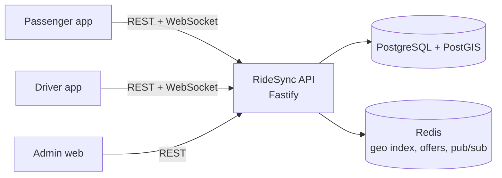

# RideSync

Real-time taxi-hailing platform: passenger app, driver app, admin web, Node.js backend.
**Status:** feature-complete backend and admin web (rides, offers, live location, load test). Remaining: final documentation and the `v1.0.0` tag. Portfolio project, not production software.

## Problems this project demonstrates

1. Preventing double booking when two drivers accept the same ride at once. Proven by `services/api/test/accept.test.ts`: 20 drivers race for one ride, ten rounds, and exactly one ever wins.
2. Reliable background location on iOS and Android.
3. A backend that handles 250 drivers sending a location every 3 seconds.

Each one is backed by an automated test or a load-test result in this repo.

## Documentation

- [Product brief](docs/00-product-brief.md)
- [Requirements and user stories](docs/01-requirements.md)
- [Architecture](docs/02-architecture.md)
- [Data model](docs/03-data-model.md)
- [API outline](docs/04-api-outline.md)
- [OpenAPI description](docs/openapi.yaml)
- [OpenAPI description](docs/openapi.yaml)
- [Backlog and milestones](docs/05-backlog.md)
- [Engineering process](docs/06-engineering-process.md)
- [Build plan](docs/07-build-plan.md)
- [Decisions (ADRs)](docs/decisions/)

## Architecture



Commands go over REST, live updates over WebSocket. Postgres holds users, drivers and rides. Redis holds the latest driver positions and offer state. More detail in [docs/02-architecture.md](docs/02-architecture.md).

## How to run

Requires Node 22, pnpm 10 and Docker.

```bash
pnpm install
cp .env.example .env
pnpm test          # unit tests
pnpm --filter @ridesync/api dev   # API on http://localhost:3000/health
docker compose up --build         # API + PostGIS + Redis (the db image is built locally and runs natively on arm64 and amd64)
```

Checks run in CI on every push: format, lint, typecheck, test, build.

## Licence

MIT

## Driver simulator

`tools/simulator` signs up fake drivers, sets them online and sends a location over the WebSocket every few seconds. With the API running:

```bash
DRIVERS=250 INTERVAL_MS=3000 DURATION_S=60 npx pnpm@10.28.0 --filter @ridesync/simulator start
```

## Load test results

`tools/k6/drivers.js` holds 250 WebSocket connections open for 60 seconds, each sending a location every 3 seconds (see [tools/k6/README.md](tools/k6/README.md)). One API process, PostGIS and Redis ran in Docker on an Apple Silicon laptop (arm64 database image).

| Metric                | Result | Target   |
| --------------------- | ------ | -------- |
| Drivers connected     | 250    | 250      |
| Locations sent        | 4885   | -        |
| Location ack p95      | 25 ms  | < 200 ms |
| WebSocket connect p95 | 17 ms  | < 1 s    |
| Successful upgrades   | 100%   | > 99%    |

Locations sent is slightly higher than acks received because the last message of some drivers is still in flight when the sockets close.
